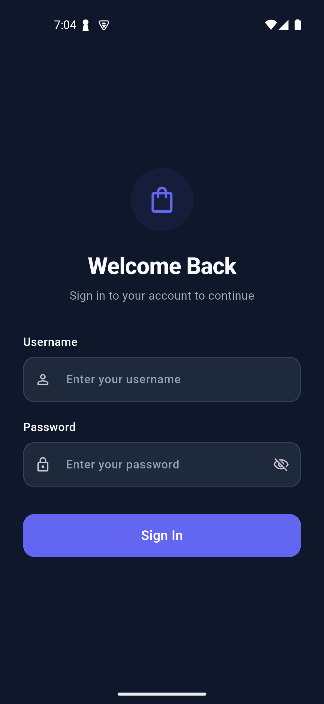
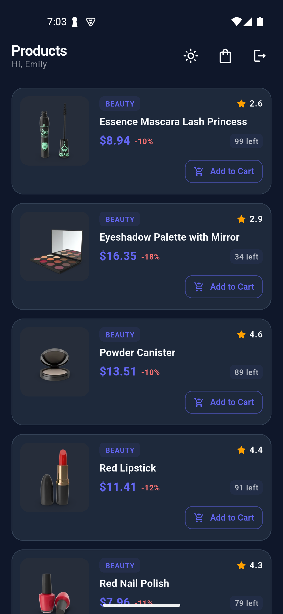

# Store & Catalog Application — Architecture & Technical Specifications

A production-grade, security-focused Flutter application demonstrating modern software design principles, strict layer decoupling, and enterprise-ready mobile architecture consuming the [DummyJSON API](https://dummyjson.com).

---

## 📱 Application Interface

| Authentication Screen | Product Catalog & Inventory |
| :---: | :---: |
|  |  |

---

## 🏛️ 1. Architectural Philosophy: Feature-First Clean Architecture

The core architectural goal of this codebase is **maintainability, scalability, and strict testability**. To achieve this, the system is designed around a **Feature-Driven Clean Architecture**.

### Why Feature-First over Layer-First?
In a traditional horizontal (layer-first) architecture, code is grouped by technical role (`/screens`, `/models`, `/services`). As an application scales:
* High friction arises because modifying a single feature requires navigating across the entire repository.
* Unintended coupling develops between unrelated features sharing generic folders.
* Team parallelization is hindered by merge conflicts in shared model and service directories.

By organizing into **vertical slices by business domain** (`features/auth`, `features/products`, `features/cart`):
* **Bounded Contexts**: Each feature owns its models, logic, presentation, and data sources.
* **Autonomous Modules**: Features can be modified, tested, or deleted with zero collateral damage to neighboring features.
* **Cognitive Ease**: Developers only focus on files relevant to the specific business capability.

### Separation of Concerns: The 4 Bounded Layers

Every feature is segmented into four deterministic, unidirectional layers:

```
┌─────────────────────────────────────────────────────────────────┐
│                       Presentation Layer                        │
│          (Stateless/Consumer Widgets, UI State Listeners)       │
└────────────────────────────────┬────────────────────────────────┘
                                 │ Dispatches User Actions
                                 ▼
┌─────────────────────────────────────────────────────────────────┐
│                       Application Layer                         │
│           (Riverpod StateNotifiers, Domain Orchestration)       │
└────────────────────────────────┬────────────────────────────────┘
                                 │ Invokes Contracts
                                 ▼
┌─────────────────────────────────────────────────────────────────┐
│                         Domain Layer                            │
│           (Pure Entities, Abstract Repository Contracts)        │
└────────────────────────────────▲────────────────────────────────┘
                                 │ Implements Contracts
                                 │
┌────────────────────────────────┴────────────────────────────────┐
│                          Data Layer                             │
│     (Remote Data Sources, Network Client, Exception Mapping)    │
└─────────────────────────────────────────────────────────────────┘
```

1. **Domain Layer (`domain/`)**: The innermost, pure business layer. Contains business entities and abstract repository definitions. It is strictly framework-agnostic with **zero dependencies on Flutter, widgets, or third-party network libraries**. This guarantees that business rules can be verified with lightning-fast pure Dart unit tests.
2. **Data Layer (`data/`)**: Manages external data sources. It implements the domain's repository contracts, coordinates with the centralized API client, parses JSON, and transforms transport-level HTTP errors into domain-specific, strongly-typed `Failure` objects.
3. **Application Layer (`application/`)**: Coordinates business logic and maintains the view state using Riverpod. It acts as an orchestrator between presentation intents and domain repositories, ensuring the UI remains purely reactive.
4. **Presentation Layer (`presentation/`)**: The visual delivery mechanism built with Material 3. Widgets operate as declarative views that observe state and emit user events. **Widgets never execute business logic, manipulate storage, or make direct network calls.**

---

## 🗂️ 2. Directory Structure Strategy

The project separates universal infrastructure (`core/`) from domain-specific verticals (`features/`):

```
lib/
├── core/                               # Foundational infrastructure & cross-cutting concerns
│   ├── constants/                      # Endpoint configurations & storage identifiers
│   │   ├── api_endpoints.dart
│   │   └── storage_keys.dart
│   ├── errors/                         # Structured hierarchy of Failures & Exceptions
│   │   ├── exceptions.dart             # Infrastructure-level error representations
│   │   └── failures.dart               # Domain-level failure representations
│   ├── network/                        # Centralized networking pipeline
│   │   ├── api_client.dart             # Unified Dio client with timeouts & global config
│   │   ├── auth_interceptor.dart       # Automated Bearer injection & 401 eviction
│   │   └── session_notifier.dart       # Decoupled session lifecycle broadcaster
│   ├── router/                         # Declarative routing & access control
│   │   └── app_router.dart             # GoRouter configuration & reactive auth guards
│   ├── storage/                        # Hardware-backed cryptographic persistence
│   │   ├── secure_storage_provider.dart
│   │   └── secure_storage_service.dart
│   ├── theme/                          # Design tokens, color schemes & mode management
│   │   ├── app_theme.dart              # Curated light and dark palettes
│   │   └── theme_provider.dart         # Global ThemeMode controller
│   └── widgets/                        # Atomic reusable UI components
│       ├── custom_error_widget.dart    # Graceful failure state with retry mechanism
│       ├── custom_loading_indicator.dart # Brand-aligned activity indicator
│       ├── empty_state_widget.dart     # Feedback for empty data collections
│       └── splash_screen.dart          # Cold-start session verification placeholder
├── features/
│   ├── auth/                           # Authentication domain vertical
│   │   ├── application/                # AuthController & immutable AuthState
│   │   ├── data/                       # AuthRemoteDataSource & AuthRepositoryImpl
│   │   ├── domain/                     # UserEntity & AuthRepository contract
│   │   └── presentation/               # LoginScreen & localized auth widgets
│   ├── cart/                           # Shopping bag domain vertical
│   │   ├── application/                # CartController & live stock calculations
│   │   ├── domain/                     # CartItemEntity & item math
│   │   └── presentation/               # CartScreen, CartBadgeButton, CartItemTile
│   └── products/                       # Catalog & inventory vertical
│       ├── application/                # ProductsController & pagination state
│       ├── data/                       # ProductsRemoteDataSource & ProductsRepositoryImpl
│       ├── domain/                     # ProductEntity, ProductsPageEntity, ProductsRepository
│       └── presentation/               # ProductsListScreen, ProductDetailScreen, ProductCard
└── main.dart                           # Application entry point with ProviderScope
```

---

## ⚡ 3. State Management Decisions: Why Flutter Riverpod?

**Flutter Riverpod** was selected as the state management backbone based on several key architectural factors:

1. **Compile-Time Safety & Reliability**:
   Unlike standard `Provider`, Riverpod providers are globally declared compile-time constants. This eliminates runtime `ProviderNotFoundException` issues and makes state declaration transparent and safe.
2. **Widget-Tree Decoupling**:
   In complex architectures, background services, network interceptors, and routers need to read and manipulate state outside the widget build context. Riverpod's `Ref` abstraction allows safe state reading and listening without requiring a `BuildContext`.
3. **Explicit Asynchronous State (`AsyncValue<T>`)**:
   Handling network-dependent data with `AsyncValue` enforces clean state handling (`data`, `loading`, `error`) via `.when()`, preventing unhandled loading flickers or silent exceptions.
4. **Selective Granular Rebuilds**:
   Using `ref.watch(provider.select(...))` enables widgets to subscribe only to specific properties of a state object. For instance, modifying the cart quantity of a single product updates only that item's counter, leaving the rest of the list intact.
5. **Frictionless Testability**:
   Riverpod allows overriding any provider at the test boundary (`ProviderScope(overrides: [...])`), enabling robust unit and widget testing without cumbersome mocking boilerplate.

---

## 🔒 4. Security Architecture & Threat Mitigation

Mobile security was treated as a primary constraint rather than an afterthought. The application implements standard defensive engineering patterns:

### Hardware-Backed Cryptographic Persistence
* Standard unsecured options like `SharedPreferences` write plaintext data to the device sandbox, exposing authentication tokens to rooted devices or backup extraction attacks.
* The app employs `flutter_secure_storage`:
  * **Android**: Uses the Android Keystore system with AES-GCM cipher encryption and encrypted shared preferences (`AndroidOptions(resetOnError: true)`).
  * **iOS**: Stores credentials in the secure iOS Keychain with `KeychainAccessibility.first_unlock`.

### Centralized Transport Security
* **Automated Token Decoration**: An `AuthInterceptor` decorates outgoing HTTP requests with the active `Authorization: Bearer <token>` header dynamically. Tokens are never passed manually through application layers.
* **Leak Prevention**: Console loggers in `ApiClient` explicitly suppress printing sensitive request bodies, passwords, and authorization headers in production builds, preventing credential exposure through system logs.

---

## 🔄 5. Session Management & Lifecycle Architecture

A robust mobile application must gracefully handle session initiation, persistence across process death, and authorization expiry.

### Seamless Cold-Start Strategy (Zero-Glimpse Initialization)
When an app process is terminated and relaunched, reading cryptographic keys from hardware storage takes asynchronous time. A naive router configuration often renders the default login screen while storage reads are pending, resulting in an unpolished visual glitch if the user is already authenticated.

* **Architecture**: The application initializes its declarative router at `/splash`.
* **State Guarding**: The router observes `AuthController`. While the session state is verifying (`AuthState.initial()`), the app displays the minimalist splash screen.
* **Direct Resolution**:
  * If valid credentials exist: The user transitions **directly to the authenticated catalog screen**. The login interface is never instantiated.
  * If no credentials exist: The user transitions smoothly to `/login`.

### Automated 401 Eviction Pipeline
Session revocation must be handled deterministically without requiring every individual API call to implement custom 401 error logic.

```
[ API Response: 401 Unauthorized ]
                │
                ▼
      [ AuthInterceptor ] ──► Purge Secure Storage (Tokens & Cache)
                │
                ▼
     [ SessionNotifier ] ──► Broadcast Expiration Event
                │
                ▼
      [ AuthController ] ──► Transition to AuthState.unauthenticated
                │
                ▼
     [ GoRouter Redirect ] ──► Route user to /login with notification
```

When any endpoint returns `401 Unauthorized`, the `AuthInterceptor` intercepts the response, immediately purges all credentials from secure storage, and notifies the application. The router reactively redirects the view to `/login`, ensuring that stale, unauthorized sessions cannot linger.

---

## 🎨 6. UI/UX Design System & Interaction Strategy

The interface strictly follows Material 3 design guidelines with an emphasis on clarity, responsiveness, and tactile feedback:

* **Adaptive Theming (Light & Dark Mode)**: 
  * Light Mode uses a clean, minimal palette (Soft Off-White `#F8FAFC`, Deep Slate `#1E293B`, and Indigo `#4F46E5`).
  * Dark Mode employs high-contrast slate surfaces (`#0F172A` and `#1E293B`) with vibrant accents (`#6366F1`) to reduce eye strain and preserve power on OLED panels.
  * Buttons enforce high-contrast, pure-white text styling (`Colors.white`) across all interaction states.
* **Real-Time Inventory Feedback**:
  * Cart adjustments recalculate available stock dynamically (`product.stock - inCart`).
  * An `AnimatedSwitcher` applies smooth slide-and-fade micro-animations to inventory counters as stock levels adjust.
* **Full Cart Management**:
  * Dedicated shopping bag screen featuring live line-item totals, order summary breakdown (subtotal, shipping fees, tax), and simulated checkout fulfillment.
  * Interactive quantity steppers embedded in both catalog cards and detail screens.
* **Tactile Scroll Dynamics**:
  * Configured with bouncing scroll physics and an end-of-catalog visual confirmation indicator when pagination reaches completion.
  * Hero transitions animate product images smoothly between the catalog view and product detail screen.

---

## 🧪 7. Verification & Automated Quality Assurance

The codebase includes automated test suites covering core domain logic, state machines, and end-to-end widget navigation:

### Static Analysis
```bash
dart analyze lib test
```

### Test Suite Execution
```bash
flutter test
```

### Verified Scenarios:
1. **Domain Layer**: Entity deserialization and mathematical discount calculations.
2. **Application Layer**: Cart controller inventory adjustments, item deletion, and subtotal calculation.
3. **Session Guards**: Verification of unauthenticated redirection to the login view.
4. **Cold-Start Verification**: Validated that existing session tokens bypass the login screen entirely during startup.

---

## 🔑 Test Account Credentials
* **Username**: `emilys`
* **Password**: `emilyspass`
